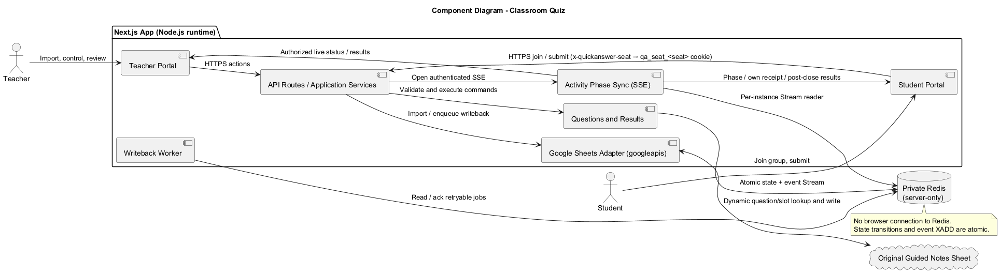
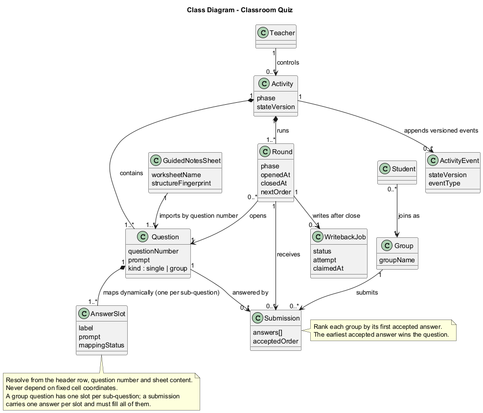
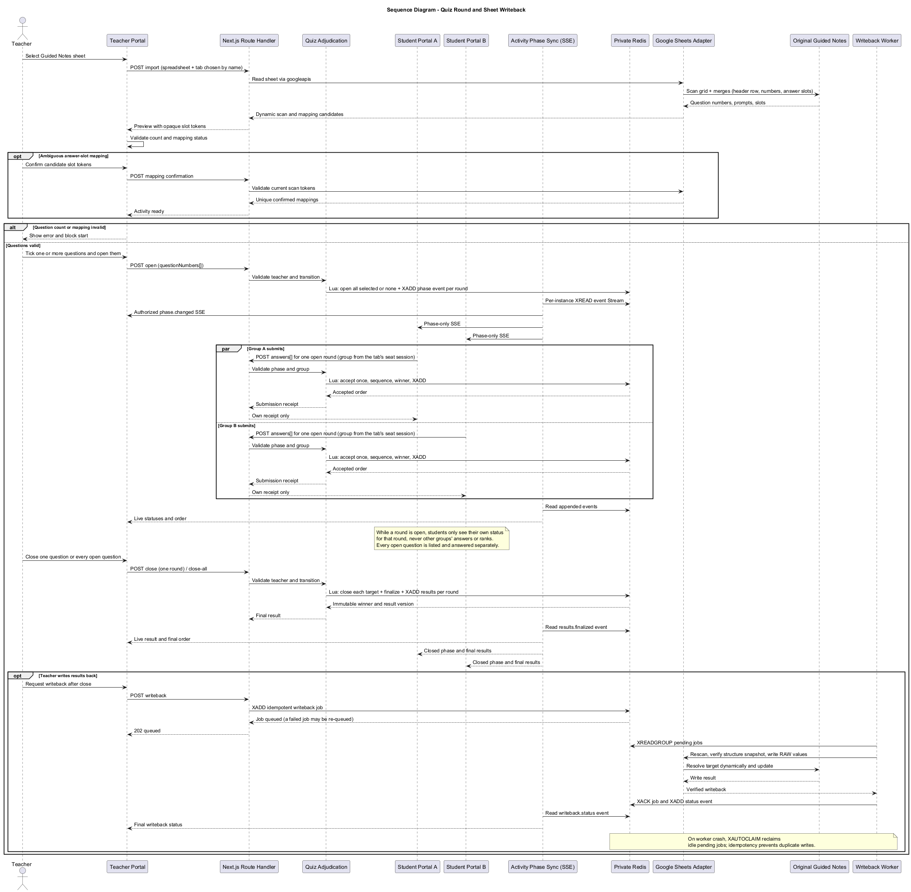

# 2026-SW-quickanswer：課堂搶答系統

NCU SE6005 2026 期末專案「Vibe Coding 課堂搶答系統」的 SpecKit 組實作。

老師從 Google 雲端硬碟匯入 Guided Notes 試算表，開放題目讓各組搶答，結束後選定正確答案，系統再把答案寫回原本那份試算表的作答格。整套系統直接讀寫老師的線上 Google Sheets，不使用離線的 `.xlsx` 檔。

程式都在 [`main/`](main/) 資料夾裡，以下指令若沒有特別說明，都在 `main/` 底下執行。

## 目錄

- [功能](#功能)
- [系統架構](#系統架構)
- [快速開始](#快速開始)
- [操作流程](#操作流程)
- [Guided Notes 格式](#guided-notes-格式)
- [API 與即時事件](#api-與即時事件)
- [測試](#測試)
- [SpecKit 開發流程](#speckit-開發流程)
- [注意事項與疑難排解](#注意事項與疑難排解)

## 功能

### 老師

- 用 Google 帳號登入，透過 Google Picker 從雲端硬碟選擇試算表，系統會自動選好工作表分頁。
- 匯入前會檢查題號：重複、缺號或找不到作答格時會列出是哪一題、哪一列，並擋下匯入。
- 支援單題與題組（一題有多個子題）。
- 勾選一題或多題後同時開放搶答，也可以只結束其中一題，或一次結束全部。
- 即時看到每組有沒有送出、送出的答案與先後順序。
- 題目結束後選擇要寫回試算表的答案：預設是最快送出的那組，可以改選任何一組，也可以自己輸入正確答案（「老師提供」）。選錯了可以重新選擇再回填一次。
- 教師工作區的「我的課堂活動」清單會列出自己的活動；不小心離開控制台時，從這裡點一下就能回去，原本的狀態都還在。
- 「關閉房間」會結束整個活動：還開著的題目一起結束，學生不能再加入或作答，但老師仍可查看結果與回填答案。

### 學生

- 輸入老師提供的 6 碼活動代碼，選擇組別並輸入名稱即可加入，不需要登入。
- 老師開放的題目會由上往下列出，每題各自作答、送出；題組要填完所有子題才能送出。每組每題只能送出一次。
- 作答期間只看得到自己組的送出狀態，看不到其他組的答案，也看不到哪一組最快。
- 題目結束後看到自己組的答案與送出順序。老師回填成功後，才會再看到正確答案，並標示是哪一組的答案或「老師提供」。
- 每個瀏覽器分頁都有自己的組別身分，同一台電腦開兩個分頁就能分別當不同組。

### 公平與隱私

- 先後順序由伺服器上的 Redis Lua 腳本決定，不看學生電腦的時間；同時送出也只會有一組排在第一。
- 伺服器依身分過濾資料，學生收到的 API 回應與即時事件都只包含自己組的資料。
- 不使用寫死的儲存格座標：匯入與每次回填前都會重新掃描工作表。如果題目結構在匯入後被改動，回填會直接失敗，不會寫到錯的格子。

## 系統架構

| 層 | 技術 |
|---|---|
| 前端與 API | Next.js 16（App Router、Turbopack）、React 19、TypeScript |
| 狀態與即時同步 | Redis 7（Lua 腳本保證原子性、Streams 保存事件），以 Server-Sent Events 推送給瀏覽器 |
| Google 整合 | Google Sheets API v4（`googleapis`）、Google Picker、OAuth 2.0（`openid`、`drive.file`） |
| 回填 | 獨立的 worker 程式，從 Redis Stream 取出回填工作後寫入試算表；程式中斷時可由其他 worker 接手 |
| 驗證與測試 | zod、Vitest、Playwright |

元件圖、類別圖與時序圖放在 [`main/diagrams/`](main/diagrams/)。下面是最新的整體圖，各功能自己的圖則以編號開頭，例如 `005-sequence.png`。

<details>
<summary>元件圖</summary>



</details>

<details>
<summary>類別圖</summary>



</details>

<details>
<summary>時序圖</summary>



</details>

### 專案結構

```text
main/
├─ src/
│  ├─ app/          Next.js 頁面與 API Route Handlers
│  ├─ components/   教師端、學生端與共用 UI
│  ├─ features/     活動（activities）與試算表（sheets）的商業邏輯
│  ├─ lib/          共用的驗證、錯誤碼與分頁 session 工具
│  └─ server/       Google 登入、Redis（含 Lua 腳本）、SSE 事件、回填 worker
├─ tests/           unit / contract / integration / security / load / architecture / e2e
├─ specs/           SpecKit 文件，每個功能一個資料夾（001–006）
├─ diagrams/        PlantUML 原始檔（.puml）與輸出的 PNG
└─ .specify/        SpecKit 的 constitution 與範本
```

## 快速開始

### 1. 需要的環境

- Node.js 22 以上
- pnpm（版本由 `package.json` 的 `packageManager` 欄位指定，可用 `corepack enable` 啟用）
- Docker（用來啟動 Redis）
- 一個 Google 帳號，以及 Google Cloud 專案（下一步建立）

### 2. 設定 Google Cloud

系統要讀寫老師雲端硬碟上的試算表，所以需要自己的 Google Cloud 專案。以下設定都是免費的。

1. **建立專案**：到 [Google Cloud Console](https://console.cloud.google.com/) 建立一個新專案。
2. **啟用 API**：啟用 **Google Sheets API** 與 **Google Picker API**。
3. **OAuth 同意畫面**（Google Auth Platform）：
   - 使用者類型選「外部」，發布狀態維持「測試中」。
   - 範圍加入 `openid` 與 `https://www.googleapis.com/auth/drive.file`。這兩個都是非敏感範圍，不需要送 Google 審核。
   - 在「測試使用者」加入要登入的 Gmail。測試模式下只有名單上的帳號能登入。
4. **OAuth 用戶端 ID**：類型選「網頁應用程式」。
   - 已授權的 JavaScript 來源：`http://localhost:3000`
   - 已授權的重新導向 URI：`http://localhost:3000/api/auth/google/callback`（必須完全一致，結尾不能多斜線）
5. **API 金鑰**（給 Picker 用）：建議限制只能呼叫 Google Picker API，網站限制設為 `http://localhost:3000/*`。
6. **專案編號**：在專案資訊主頁可以看到，是一串純數字。注意不是英數混合的「專案 ID」。

### 3. 設定環境變數

```bash
cd main
cp .env.example .env.local
```

接著編輯 `.env.local`：

| 變數 | 說明 |
|---|---|
| `REDIS_URL` | 預設 `redis://127.0.0.1:6379`，與 `docker-compose.yml` 一致 |
| `APP_BASE_URL` | 網站網址，預設 `http://localhost:3000` |
| `SESSION_SECRET` | 簽署登入 cookie 用的密鑰，至少 32 個字元 |
| `TOKEN_ENCRYPTION_KEY` | 加密 Google token 用的金鑰，必須是 32 bytes 的 base64 字串 |
| `GOOGLE_CLIENT_ID` / `GOOGLE_CLIENT_SECRET` | 第 2 步建立的 OAuth 用戶端 |
| `GOOGLE_REDIRECT_URI` | 必須與 Google Cloud 裡登記的重新導向 URI 完全一致 |
| `NEXT_PUBLIC_GOOGLE_PICKER_API_KEY` | 第 2 步建立的 API 金鑰 |
| `NEXT_PUBLIC_GOOGLE_CLOUD_PROJECT_NUMBER` | 第 2 步的專案編號（純數字） |
| `ACTIVITY_TTL_SECONDS` | 活動資料在 Redis 保留多久，預設 604800 秒（7 天） |
| `WRITEBACK_CLAIM_IDLE_MS` | 回填工作卡住多久後由其他 worker 接手，預設 30000 毫秒 |

`SESSION_SECRET` 與 `TOKEN_ENCRYPTION_KEY` 可以用下面的指令產生，跑兩次各填一個：

```bash
node -e "console.log(require('crypto').randomBytes(32).toString('base64'))"
```

> `.env.local` 已被 `.gitignore` 排除。請不要把真實的金鑰、密碼提交到 repo，也不要貼到文件或 issue 裡。

### 4. 啟動

```bash
cd main
pnpm install --frozen-lockfile
docker compose up -d redis          # 只開在 127.0.0.1:6379
pnpm dev                            # 網站：http://localhost:3000
pnpm worker:sheets-writeback        # 另開一個終端機，負責把答案寫回試算表
```

開啟 <http://localhost:3000/api/health>，看到 `{"status":"ok","redis":"ok"}` 就代表網站與 Redis 都正常。

要回填答案時，網站和 worker 都必須在執行；只開網站的話，回填工作會停在排隊中。

## 操作流程

### 老師

1. 開啟 <http://localhost:3000>，進入「教師工作區」並用 Google 登入。
2. 按「從 Google 雲端硬碟選取」，挑選 Guided Notes 試算表（建議先建立一份複本），系統會自動選好分頁。
3. 在「組別名稱」填入組別，以逗號分隔（例如 `teamA,teamB`，2 到 32 組，名稱不可重複），按「匯入並預覽」，確認題數與每題的作答格。
4. 進入教師控制台，把畫面上的 6 碼活動代碼給學生。
5. 勾選要開放的題目後按「開放所選題目」，再看各組的送出狀態與順序。
6. 結束題目後，在該題選擇要採用的答案（某一組，或自己輸入），按「回填所選答案」寫入試算表。之後改選其他答案，也可以按「重新回填」。
7. 活動結束時按「關閉房間」並確認。之後仍可在「我的課堂活動」回到控制台查看結果或回填。

### 學生

1. 開啟 <http://localhost:3000/join>，輸入 6 碼活動代碼後按「查詢」。
2. 選擇組別、填入顯示名稱，按「加入組別」。
3. 老師開放題目後，在題目卡片上作答並送出。
4. 題目結束後可以看到自己組的答案；老師回填完成後，會再看到正確答案。

> 在同一台電腦測試多組時，每組開一個分頁即可，各分頁的組別身分互不影響。

## Guided Notes 格式

系統支援兩種版面，匯入時會自動判斷：

**表格版面（官方範本）**

- 某一列是標題列，包含「題號」與「作答」（或「答案」）欄，「題目」欄可有可無。
- 標題列下方每一列是一題，題號欄填數字，例如 `1`、`第 1 題`、`1.`。
- **題組**：子題放在題目下方連續的列，題號儲存格往下合併或留空；每個子題列要有子題敘述，或作答格以 `（1）`、`（2）` 開頭。每個子題各有一個作答格，回填時會寫成 `（1）答案一`、`（2）答案二`。
- 標題列可以不在第一列，前後插入欄或列也能正確辨識。

**記號版面**

- 題目格以題號開頭，例如 `1. 題目`、`Question 1: 題目`、`1題：題目`。
- 在該題的作答格放入記號 `{{answer:1}}`，也可以寫成 `{{blank:1}}` 或 `[[answer:1]]`。

**兩種版面共通的規則**

- 題號必須從 1 開始連續編號，而且不能重複。
- 每一題都要有自己的作答格，不能和其他題共用。
- 回填只會寫入作答格，其他儲存格不會被改動。如果匯入後刪除或搬動了題目，回填會失敗並提示結構已變更，不會寫錯格子。

## API 與即時事件

所有 API 都在 `main/src/app/api/` 底下。「教師」表示需要 Google 登入；「學生」表示需要加入活動後取得的分頁 session。

| 方法 | 路徑 | 用途 | 身分 |
|---|---|---|---|
| GET | `/api/health` | 檢查網站與 Redis | 不限 |
| GET | `/api/auth/google/start` | 開始 Google 登入 | 不限 |
| GET | `/api/auth/google/callback` | Google 登入完成後的回呼 | 不限 |
| GET | `/api/auth/google/picker-token` | 取得 Picker 用的短期 access token | 教師 |
| GET | `/api/sheets/{spreadsheetId}/tabs` | 列出試算表的分頁 | 教師 |
| POST | `/api/activities/import` | 匯入試算表並建立活動 | 教師 |
| POST | `/api/activities/{activityId}/mappings/confirm` | 確認無法自動判斷的作答格 | 教師 |
| GET | `/api/teacher/activities` | 我的課堂活動清單 | 教師 |
| POST | `/api/activities/{activityId}/rounds/open` | 開放題目（`questionNumbers[]`） | 教師 |
| POST | `/api/activities/{activityId}/rounds/{roundId}/close` | 結束一題 | 教師 |
| POST | `/api/activities/{activityId}/rounds/close-all` | 結束所有開放中的題目 | 教師 |
| POST / GET | `/api/activities/{activityId}/rounds/{roundId}/writeback` | 排入回填（可帶 `selection` 指定採用的答案）／查詢回填狀態 | 教師 |
| POST | `/api/activities/{activityId}/close` | 關閉房間 | 教師 |
| GET | `/api/activities/join?code=` | 以活動代碼查詢活動 | 不限 |
| POST | `/api/activities/{activityId}/join` | 選擇組別加入活動 | 學生 |
| POST | `/api/activities/{activityId}/rounds/{roundId}/submissions` | 送出答案（`answers[]`） | 學生 |
| GET | `/api/activities/{activityId}/rounds/{roundId}/results` | 查詢題目結果（依身分過濾） | 教師、學生 |
| GET | `/api/activities/{activityId}/events` | Server-Sent Events 即時事件 | 教師、學生 |

回填的 `selection` 參數有兩種寫法，不帶的話預設採用最快的那組：

```json
{ "selection": { "source": "group", "groupId": "teamB" } }
{ "selection": { "source": "teacher", "answers": ["CPU", "作業系統"] } }
```

即時事件（SSE）：

| 事件 | 收到的人 | 內容 |
|---|---|---|
| `activity.snapshot` | 教師、學生 | 連線或重新連線時的完整狀態，依身分過濾 |
| `phase.changed` | 教師、學生 | 題目開放 |
| `submission.accepted` | 教師 | 某一組送出答案 |
| `submission.receipt` | 學生 | 自己組的送達回條 |
| `results.finalized` | 教師、學生 | 題目結束；學生只收到自己組的答案 |
| `writeback.status` | 教師 | 回填工作的狀態 |
| `answer.published` | 學生 | 回填成功後公布老師採用的答案 |
| `activity.ended` | 教師、學生 | 房間已關閉 |

## 測試

```bash
cd main
pnpm lint && pnpm typecheck
pnpm test:unit          # 解析器、領域邏輯
pnpm test:contract      # API 的輸入輸出格式
pnpm test:integration   # 需要 Redis：Lua 腳本、搶答順序、回填佇列
pnpm test:security      # 學生看不到其他組資料、分頁身分隔離
pnpm test:load          # 需要 Redis：500 個 SSE 連線
pnpm exec vitest run    # 一次跑完上面所有 Vitest 測試
```

- 整合測試與負載測試會連到 `REDIS_URL`（預設本機的 Redis），請先 `docker compose up -d redis`。
- 自動測試以替身模擬 Google API，不會連到真的 Google 帳號；實際讀寫 Google Sheets 的驗證紀錄寫在各功能的 `quickstart.md`。
- e2e 測試需要先安裝 Playwright 瀏覽器：

  ```bash
  pnpm exec playwright install chromium
  pnpm test:e2e
  ```

## SpecKit 開發流程

每個功能都依照 SpecKit 流程開發，並在自己的 `feat/NNN-...` 分支完成後以 Pull Request 合併：

1. **specify**：撰寫 `spec.md`（使用者情境、需求、驗收條件）
2. **clarify**：釐清規格中不明確的地方
3. **畫圖**：依 constitution 第 VI 條「Design-First with PlantUML」，先畫元件圖、類別圖、時序圖並輸出 PNG
4. **plan**：`plan.md`、`research.md`、`data-model.md`、`contracts/`
5. **tasks**：`tasks.md`，拆成可驗證的任務
6. **analyze**：檢查規格、計畫與任務是否一致
7. **implement**：先寫測試再實作，完成後核對圖表與程式是否一致，並記錄人工驗證結果

| 編號 | 功能 | 文件 |
|---|---|---|
| 001 | 課堂搶答核心流程：匯入、開題、搶答、結果、回填 | [`specs/001-live-classroom-quiz`](main/specs/001-live-classroom-quiz/) |
| 002 | 支援官方 Guided Notes 範本、題組、任一已結束題目都能回填 | [`specs/002-guided-notes-template-import`](main/specs/002-guided-notes-template-import/) |
| 003 | 每個瀏覽器分頁有獨立的組別身分 | [`specs/003-tab-scoped-sessions`](main/specs/003-tab-scoped-sessions/) |
| 004 | 多題同時開放搶答、題目卡片介面 | [`specs/004-multi-question-rounds`](main/specs/004-multi-question-rounds/) |
| 005 | 老師選擇回填的答案，學生只看到自己的答案與老師採用的答案 | [`specs/005-teacher-selected-answer`](main/specs/005-teacher-selected-answer/) |
| 006 | 我的課堂活動清單、關閉房間 | [`specs/006-activity-lifecycle`](main/specs/006-activity-lifecycle/) |

- 專案原則（constitution）：[`main/.specify/memory/constitution.md`](main/.specify/memory/constitution.md)
- SpecKit 指令：[`main/.github/skills/`](main/.github/skills/)（`speckit-specify`、`speckit-clarify`、`speckit-plan`、`speckit-tasks`、`speckit-analyze`、`speckit-implement` 等）

修改 `.puml` 後，用 [PlantUML](https://plantuml.com/download)（需要 Java）重新輸出 PNG：

```bash
cd main
java -jar plantuml.jar -charset UTF-8 -tpng diagrams/*.puml
```

## 注意事項與疑難排解

- **Google 授權失效**：OAuth 在測試模式下，授權大約 7 天會失效。出現「Google 授權已失效，請重新登入。」時，回到教師工作區重新登入即可。
- **登入時出現「Google 登入狀態無效或已過期。」**：登入流程中斷或停留太久時會出現，回到教師工作區再按一次登入即可。
- **登入時出現 `redirect_uri_mismatch`**：`.env.local` 的 `GOOGLE_REDIRECT_URI` 必須和 Google Cloud 登記的重新導向 URI 完全一致。
- **Picker 打不開或選不到檔案**：確認已啟用 Google Picker API，`NEXT_PUBLIC_GOOGLE_CLOUD_PROJECT_NUMBER` 填的是純數字的專案編號，而且 API 金鑰的網站限制包含 `http://localhost:3000/*`。
- **回填一直顯示排隊中**：確認 `pnpm worker:sheets-writeback` 有在執行。
- **回填失敗並提示結構已變更**：匯入後題目被刪除或搬動了，請重新匯入試算表。
- **活動不見了**：活動資料預設保留 7 天（`ACTIVITY_TTL_SECONDS`），過期後會從清單中消失。功能 006 之前匯入的活動沒有被記錄，也不會出現在「我的課堂活動」。
- **測試或 Demo 前**：請使用試算表的乾淨複本，回填會直接寫入作答格。
- **Redis 安全**：`docker-compose.yml` 只把 Redis 開在 `127.0.0.1`，不要對外開放。
